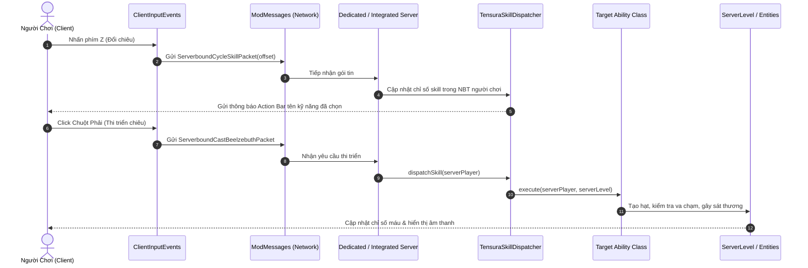

# 🏛️ MÔ HÌNH KIẾN TRÚC HỆ THỐNG (ARCHITECTURE MODEL)

## Bản Mod: `Weapons Mod — Mythical Armament & Tensura`

**Nền tảng**: Minecraft 1.21.1 | Java 21 | Fabric Loader | Architectury API

---

## 1. Tổng Quan Kiến Trúc (Architectural Overview)

Bản mod được xây dựng theo mô hình **Kiến trúc phân tầng kết hợp hướng sự kiện (Layered & Event-Driven Architecture)**, tận dụng công nghệ **Architectury Loom** để chuẩn hóa logic giữa các modloader.

```
+-----------------------------------------------------------------------+
|                             USER CLIENT                               |
|   [Giao diện Screen/GUI]      [Client Input (Z, X, PgUp)]   [Render]  |
+-----------------------------------------------------------------------+
                                  │   ▲
             Network Packets (C2S)│   │ Network Packets (S2C)
                                  ▼   │
+-----------------------------------------------------------------------+
|                          NETWORKING LAYER                             |
|          com.minhphuc.weapons.network.ModMessages                     |
|   ServerboundCycleSkillPacket         ServerboundCastBeelzebuthPacket |
|   ServerboundTengaiSwordSkillPacket   ServerboundMaterialCreation...  |
+-----------------------------------------------------------------------+
                                  │
                                  ▼
+-----------------------------------------------------------------------+
|                          DISPATCHER LAYER                             |
|      TensuraSkillDispatcher      |      EvolvedSkillDispatcher        |
+-----------------------------------------------------------------------+
                                  │
                                  ▼
+-----------------------------------------------------------------------+
|                        ABILITY / DOMAIN LAYER                         |
|   [Divine Armament]       [Tensura Demon Lord]      [Dark Gathering]  |
|   - FaithAndGraceAbility  - BeelzebuthAbility       - Taisui Stars    |
|   - DisintegrationAbility - DragonNovaAbility       - SeerFleshAbility|
|   - JacobsLadderAbility   - ThoughtAcceleration     - TengaiKyusei    |
+-----------------------------------------------------------------------+
                                  │
                                  ▼
+-----------------------------------------------------------------------+
|                    DATA & PERSISTENCE LAYER (NBT)                     |
|           EntityDataHelper | PrimordialPlayerDataHelper               |
|      (TensuraTrueDemonLord, UrielDefenseActive, SelectedSkill)        |
+-----------------------------------------------------------------------+
```

---

## 2. Phân Tách Mô-đun (Module Decomposition)

### 2.1. Mô-đun `common` (Core Module)

Chứa toàn bộ logic nghiệp vụ thuần túy không phụ thuộc nền tảng khởi chạy:

* `init`: Đăng ký tài nguyên (`ModItems`, `ModBlocks`, `ModEntities`, `ModKeyBindings`).
* `content/divine`: Vũ khí thần linh, Nguyệt Quang Thần Kiếm, Giáp Thần Thoại, kỹ năng Bí Ẩn Đức Tin & Ân Sủng, Linh Tử Băng Hoại, Nấc Thang Jacob.
* `content/tensura`: Hệ thống thức tỉnh Chân Ma Vương, Thất Đại Ác Ma Thủy Tổ, Chân Long Chủng (Velgrynd, Velzard), Ma Đạn Carrera, Bành Trướng Lãnh Địa, Kháng Ma Kết Giới.
* `content/darkgathering`: Boss Bạch Nhật Tà Thần Không Vong (Kūbō), Thái Tuế Tinh Quân, Tuyệt Diệt Tinh Tú, Thị Thực (Seer Flesh), Nghịch Thời Nhất Trảm.
* `content/evolution`: Kỹ năng tối thượng tiến hóa (Phòng Ngự Tuyệt Đối Uriel, Cảm Nhận Vạn Năng, Lồng Giam Vô Hạn).
* `network`: Xử lý gói tin mạng hai chiều giữa Client và Server.
* `data`: Quản lý lưu trữ NBT qua `EntityDataHelper`.

### 2.2. Mô-đun `fabric` (Platform Implementation)

Chịu trách nhiệm cầu nối môi trường Fabric:

* Entry point Mod initializer (`WeaponsModFabric.java`).
* Client initializer (`WeaponsModFabricClient.java`), đăng ký client renderers, screens, key event callbacks.

---

## 3. Đường Ống Truyền Dữ Liệu Mạng (Network Data Pipeline)

Mod áp dụng cơ chế **Server-Authoritative** (Máy chủ là cơ quan ra quyết định cuối cùng) để đảm bảo không bị cheat, đồng bộ hoàn hảo trong môi trường Multiplayer:



---

## 4. Quản Lý Dữ Liệu Thực Thể & Trạng Thái (Persistence Model)

* Dữ liệu người chơi (Trạng thái Ma Vương, Kỹ năng chọn, Uriel Defense ON/OFF, Thân phận Thủy Tổ) được lưu trữ trực tiếp vào **CompoundTag** thông qua `EntityDataHelper.getCustomData(player)`.
* **Ưu điểm**:
  1. Không làm xáo trộn cấu trúc Player NBT mặc định của Minecraft.
  2. Bền vững qua các lần lưu thế giới (World Save / Reload / Server Restart).
  3. Tự động phục hồi hoặc reset có kiểm soát khi người chơi tử trận (`EvolvedSkillHelper.resetOnDeath`).

---

## 5. Chiến Lược Hiệu Năng & Giảm Thiểu Độ Trễ (Zero Lag Architecture)

1. **Thuật toán hạt không phụ thuộc Entity**: Thay vì spawn hàng loạt Armor Stand vô hình gây tắc nghẽn server tick, toàn bộ vòng tròn ma pháp và hiệu ứng chiêu thức (Disintegration, Dragon Nova, Jacob's Ladder, Faith and Grace) đều được tính toán bằng ma trận xoay Vector 3D (`Vec3`, `Quaternion`) và phát trực tiếp qua `ServerLevel.sendParticles()`.
2. **Không Cooldown nhưng Không Gây Đơ Server**: Tối ưu hóa chu kỳ quét mục tiêu theo phạm vi AABB (`BoundingBox`) có giới hạn bán kính, tránh quét toàn bộ Level.
3. **Quản lý Vòng đời Ma Trận (Ticking Lifecycles)**: Các kỹ năng kéo dài (như Bí Ẩn Đức Tin 5 giây, Lồng Giam Vô Hạn) sử dụng danh sách `tickRituals` được dọn sạch ngay khi hết hạn (`it.remove()`).
4. **Shader Manga Trắng Đen Siêu Tối Ưu (`ClientTengaiMangaHandler`)**: Tận dụng pipeline post-effect tích hợp của Minecraft (`minecraft:shaders/post/desaturate.json`) thay vì tính toán bộ lọc thủ công trên CPU; tự tắt sau 16 ticks hoặc khi thoát thế giới.
5. **Cơ Chế Phân Thân Tàn Ảnh Tự Hủy**: Tuyệt kỹ Nghịch Thời Nhất Trảm chỉ duy trì 1 ArmorStand tàn ảnh mang Skin người chơi trong 16 ticks (0.8s), sau đó lập tức gọi `discard()`, kèm theo listener `SERVER_LEVEL_UNLOAD` để chống rò rỉ bộ nhớ (Zero Memory Leak).
