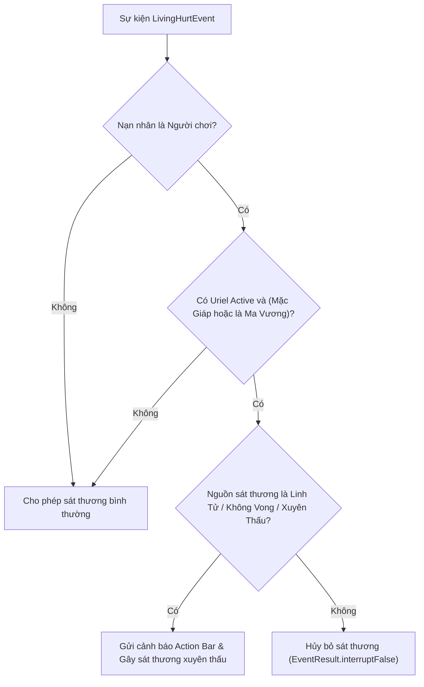

# 🎨 MẪU THIẾT KẾ PHẦN MỀM (DESIGN PATTERNS)

## Bản Mod: `Weapons Mod — Mythical Armament & Tensura`

Dự án áp dụng chặt chẽ các mẫu thiết kế hướng đối tượng (GoF Design Patterns) và các mẫu kiến trúc trong hệ sinh thái Minecraft Fabric/Architectury nhằm đảm bảo mã nguồn mạch lạc, dễ mở rộng và kiểm thử.

---

## 1. Dispatcher Pattern (Mẫu Bộ Điều Phối)

* **Vị trí áp dụng**: [`TensuraSkillDispatcher`](file:///d:/Users/MinhPhuc00ne/Projects/mod-weapon/common/src/main/java/com/minhphuc/weapons/content/tensura/TensuraSkillDispatcher.java) và [`EvolvedSkillDispatcher`](file:///d:/Users/MinhPhuc00ne/Projects/mod-weapon/common/src/main/java/com/minhphuc/weapons/content/evolution/EvolvedSkillDispatcher.java).
* **Mục đích**: Tách rời hoàn toàn tầng xử lý mạng (Network Packets) khỏi việc thực thi logic chi tiết của từng kỹ năng. Khi nhận gói tin `ServerboundCastBeelzebuthPacket`, server chỉ cần gọi `TensuraSkillDispatcher.dispatchSkill(player)` mà không cần biết chiêu thức cụ thể được cấu hình như thế nào bên trong.
* **Cấu trúc**:

```java
public class TensuraSkillDispatcher {
    public static void dispatchSkill(ServerPlayer player) {
        int index = getPlayerSelectedSkill(player);
        switch (index) {
            case 0 -> SanctuaryDisintegrationAbility.cast(player);
            case 1 -> JacobsLadderAbility.cast(player);
            case 2 -> PurificationPillarAbility.cast(player);
            case 3 -> FaithAndGraceAbility.cast(player);
            case 4 -> BeelzebuthAbility.cast(player);
            ...
        }
    }
}
```

---

## 2. Strategy Pattern (Mẫu Chiến Lược)

* **Vị trí áp dụng**: Các lớp kỹ năng trong `content/divine/`, `content/tensura/`, `content/darkgathering/` (`FaithAndGraceAbility`, `BeelzebuthAbility`, `DragonNovaAbility`, `TengaiKyuseiSwordAbility`).
* **Mục đích**: Mỗi kỹ năng đại diện cho một thuật toán / chiến lược thi triển độc lập. Khi cần thay đổi cơ chế hoặc tối ưu hiệu năng của một chiêu thức, lập trình viên chỉ cần chỉnh sửa lớp chiến lược đó mà không làm ảnh hưởng đến các chiêu thức khác.

---

## 3. Factory & Deferred Registry Pattern (Mẫu Nhà Máy & Đăng Ký Trì Hoãn)

* **Vị trí áp dụng**: [`ModItems`](file:///d:/Users/MinhPhuc00ne/Projects/mod-weapon/common/src/main/java/com/minhphuc/weapons/init/ModItems.java), `ModBlocks`, `ModEntities`.
* **Mục đích**: Quản lý vòng đời khởi tạo của các đối tượng trong Minecraft. Sử dụng `DeferredRegister` của Architectury để trì hoãn việc đăng ký cho đến đúng giai đoạn của Mod Lifecycle, tránh lỗi Race Condition giữa Client và Server.

```java
public static final DeferredRegister<Item> ITEMS = DeferredRegister.create(WeaponsMod.MOD_ID, Registries.ITEM);
public static final RegistrySupplier<Item> DEMON_LORD_AWAKENING_ORB = ITEMS.register(
    "demon_lord_awakening_orb",
    () -> new DemonLordAwakeningOrbItem(new Item.Properties().rarity(Rarity.EPIC))
);
```

---

## 4. Observer & Event-Driven Pattern (Mẫu Quan Sát & Hướng Sự Kiện)

* **Vị trí áp dụng**: [`DivineWeaponEvents`](file:///d:/Users/MinhPhuc00ne/Projects/mod-weapon/common/src/main/java/com/minhphuc/weapons/content/divine/DivineWeaponEvents.java), [`TensuraEvents`](file:///d:/Users/MinhPhuc00ne/Projects/mod-weapon/common/src/main/java/com/minhphuc/weapons/content/tensura/TensuraEvents.java).
* **Mục đích**: Lắng nghe các sự kiện vòng đời của game (`TickEvent.SERVER_LEVEL_POST`, `EntityEvent.LIVING_HURT`, `PlayerEvent.PLAYER_JOIN`).
* **Ví dụ điển hình**: Khi một thực thể nhận sát thương (`LIVING_HURT`), sự kiện được bắt lại để kiểm tra trạng thái **Phòng Ngự Tuyệt Đối Uriel**:



---

## 5. Facade Pattern (Mẫu Mặt Tiền Truy Xuất Dữ Liệu)

* **Vị trí áp dụng**: [`EntityDataHelper`](file:///d:/Users/MinhPhuc00ne/Projects/mod-weapon/common/src/main/java/com/minhphuc/weapons/data/EntityDataHelper.java), [`PrimordialPlayerDataHelper`](file:///d:/Users/MinhPhuc00ne/Projects/mod-weapon/common/src/main/java/com/minhphuc/weapons/content/tensura/PrimordialPlayerDataHelper.java), [`EvolvedSkillHelper`](file:///d:/Users/MinhPhuc00ne/Projects/mod-weapon/common/src/main/java/com/minhphuc/weapons/content/evolution/EvolvedSkillHelper.java).
* **Mục đích**: Ẩn giấu sự phức tạp của hệ thống lưu trữ NBT CompoundTag bên dưới. Các thành phần khác chỉ cần gọi các phương thức ngữ nghĩa cấp cao:
  * `EvolvedSkillHelper.isUrielDefenseActive(player)`
  * `EvolvedSkillHelper.toggleUrielDefense(player)`
  * `PrimordialPlayerDataHelper.isDemonLord(player)`

---

## 6. Accessor / Mixin Pattern (Mẫu Truy Xuất Nội Bộ)

* **Vị trí áp dụng**: [`TextDisplayAccessor`](file:///d:/Users/MinhPhuc00ne/Projects/mod-weapon/common/src/main/java/com/minhphuc/weapons/mixin/TextDisplayAccessor.java).
* **Mục đích**: Cho phép mã nguồn can thiệp và đọc/ghi các trường `private` / `protected` của Minecraft Vanilla một cách an toàn mà không cần giải mã Bytecode runtime hoặc can thiệp thô bạo vào tệp nhị phân gốc.
